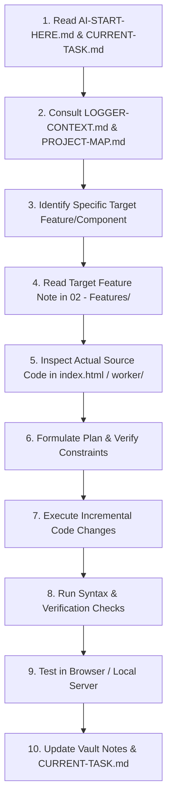

# 🚀 AI Start Here — Instruction Manual for Future Coding Sessions

> **Audience**: AI Coding Assistants (Antigravity, Claude, Cursor, Copilot, ChatGPT, Gemini, etc.) entering a fresh session on this codebase.
> **Last Updated**: October 2026
> **Tag**: `#guide` `#ai-workflow`

---

## 1. Welcome to Logger

You are pairing with **Aditya Kachare (ATOMYN)** on **Logger** (repository: `Project-FlickShelft`).

Logger is a high-performance, single-page Progressive Web App (PWA) designed as a **personal media diary**. It allows users to log, rate, review, and track movies, television series, and video games they have experienced.

### Core Philosophy
1. **Zero-Framework, Single-File Simplicity**: The entire client-side frontend lives in `../index.html` (~14,000 lines of highly crafted HTML, CSS, and ES module JavaScript). There are no Node build steps (no Vite, no Webpack, no React, no Svelte).
2. **Instant Boot & Resilience**: Multi-tier local caching (`localStorage`) allows the app to load user diary entries instantly before network or Firebase authorization completes.
3. **ISP DNS Immunity**: All external API calls (TMDB for movies/TV and IGDB for games) are routed through a serverless Cloudflare Worker proxy (`../worker/src/index.js`) to prevent ISP DNS blocking on mobile carriers.
4. **Desktop & Mobile Parity**: Mobile-first touch interactions (iOS squircle modals, swipe actions on watchlist cards, haptic feedback, native share sheet integration).

---

## 2. Repository Layout

```text
Project-FlickShelft/
├── index.html          ← ENTIRE FRONTEND: HTML, CSS, JS, Firebase SDK, App UI
├── server.js           ← Local development server (port 8080) with mock/proxy routes
├── manifest.json       ← PWA manifest (standalone display, theme color, icons)
├── icon-192.png        ← App icon (192x192)
├── icon-512.png        ← App icon (512x512)
├── logo.png            ← Wordmark branding asset
├── Patchnotes.txt      ← Historical chronological changelog (v1.0 to v2.1+)
├── AGENTS.md           ← Legacy agent technical instructions
├── README.md           ← Public repository overview
├── .gitignore          ← Excludes worker/.dev.vars and node_modules
├── worker/             ← Cloudflare Worker Serverless Backend Proxy
│   ├── src/
│   │   └── index.js    ← Production API proxy (TMDB, IGDB via Twitch, Image Proxy)
│   ├── wrangler.jsonc  ← Wrangler Cloudflare configuration (service: logger-proxy)
│   ├── package.json    ← Worker devDependencies (wrangler)
│   ├── .dev.vars       ← Local secrets for wrangler dev (gitignored)
│   ├── .dev.vars.example ← Secrets template
│   ├── test-server.ps1 ← PowerShell API test server
│   └── serve-app.ps1   ← PowerShell static dev server
└── LOGGER-VAULT/       ← THIS OBSIDIAN VAULT (Architecture, Features, Docs)
```

---

## 3. Orientation & Navigation Instructions

When asked to work on a task, **do not read the entire vault at once**. Follow this navigation trail:

1. **Orientation**:
   - Read [[LOGGER-CONTEXT]] for the high-level system overview.
   - Read [[PROJECT-MAP]] to locate specific code blocks in `../index.html` or `../worker/src/index.js`.
2. **Current Status**:
   - Read [[CURRENT-STATE]] to check implemented vs. partial features, recent fixes, and known limitations.
   - Read [[CURRENT-TASK]] to check if a task handoff is actively in progress.
3. **Targeted Research**:
   - Navigate to the specific feature note under `02 - Features/` (e.g. [[Movie Wall]], [[Watchlist]], [[Universal Search]]).
   - Navigate to the component note under `03 - Frontend/Components/` (e.g. [[Add and Edit Entry Modal]], [[Deep Media Info Card]]).
   - Read the relevant API/backend note under `04 - Backend and Integrations/` (e.g. [[Cloudflare Worker Proxy]], [[IGDB Integration]]).

---

## 4. Fundamental Development Rules

> [!IMPORTANT]
> **Source Code Is Authoritative**: If documentation in this vault ever contradicts the actual implementation in `index.html` or `worker/src/index.js`, **the source code is the ground truth**. Verify claims by reading the actual source code.

1. **Maintain Single-File Architecture**:
   - Do NOT introduce React, Vue, Svelte, Tailwind, Vite, or npm bundlers into the frontend root.
   - All client code belongs in `index.html`.
2. **Preserve Application Integrity**:
   - Do NOT relocate, reorganize, or rename source files.
   - Do NOT touch existing user authentication keys, Firebase project IDs, or Firestore collection paths (`users/{uid}/entries`).
   - Do NOT commit or leak secrets (`worker/.dev.vars` must remain gitignored).
3. **Verify Before Making Assumptions**:
   - Never assume an external endpoint exists without checking `worker/src/index.js` or `server.js`.
   - Distinguish between **implemented features** (e.g. [[Movie Wall]], [[Calendar View]]) and **abandoned historical prototypes** (e.g. [[Obsidian Graph View Sunset]] was scrapped in favor of the Movie Wall).
4. **Mobile & Performance First**:
   - Check mobile layout (`@media (max-width: 600px)`).
   - Ensure sticky positioning remains unbroken (do not add CSS `transform` to `.page.on` or parent containers).
   - Use `loading="lazy"` and `decoding="async"` on media posters.
5. **Update This Vault When Changing Code**:
   - When you introduce, modify, or remove an architectural pattern, feature, API route, or component, update the corresponding vault notes.

---

## 5. Ten-Step Procedure for a Fresh AI Session



1. **Identify the goal**: Read the user's prompt carefully. Check [[CURRENT-TASK]] to see if there is active work in flight.
2. **Locate the context**: Open [[PROJECT-MAP]] to identify the line ranges or sections in `index.html` or `worker/src/index.js`.
3. **Inspect the existing implementation**: Read the exact source lines before making any modifications.
4. **Preserve non-negotiables**: Check [[Design System]] and [[UI and UX Patterns]] to match existing visual standards (dark mode, glassmorphism, rounded corners, haptic vibration).
5. **Implement change incrementally**: Use targeted file edits rather than mass overwrites.
6. **Validate syntax**: Run `node -e "new vm.Script(fs.readFileSync('index.html', 'utf8'))"` or the local test script to ensure zero syntax errors.
7. **Verify local execution**: Ensure `node server.js` serves HTTP 200 without console errors.
8. **Update documentation**: Document any new behavior in the appropriate vault folder (`02 - Features/`, `03 - Frontend/`, etc.).
9. **Update handoff**: If work remains for future sessions, update [[CURRENT-TASK]].
10. **Report concisely**: State what was done, what was verified, and what the user can test.
