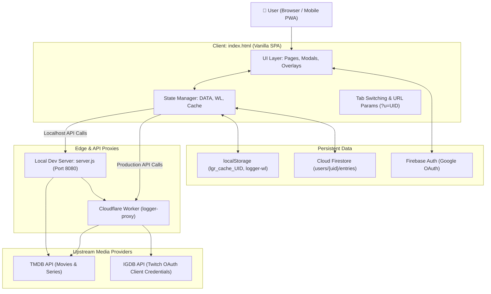

# 🧠 Logger Context — Durable Project Knowledge

> **Tag**: `#context` `#architecture` `#overview`
> **Related Notes**: [[HOME]], [[AI-START-HERE]], [[PROJECT-MAP]], [[Technology Stack]], [[System Architecture]]

---

## 1. Project Purpose & Background

**Logger** (internal repository name: `Project-FlickShelft`) is an independent personal media diary Progressive Web App created by **ATOMYN** (Aditya Kachare).

It gives movie, television, and video game enthusiasts a beautiful, friction-free way to:
- Log titles they have experienced, accompanied by custom ratings, status flags, and personal notes.
- Organize a drag-and-drop Watchlist with countdown cards for upcoming releases.
- Relive past entertainment through an edge-to-edge poster **[[Movie Wall]]** and a chronological **[[Calendar View]]**.
- Share aesthetic snapshot review cards and collection pictures with friends on social media.
- Showcase their taste through custom **[[User Profiles]]** and **[[Favorites and Top Picks]]**, which can be publicly shared via `?u=<uid>` URL parameters.

---

## 2. Technology Stack & Key Choices

| Subsystem | Technology Choice | Rationale | Note Link |
|---|---|---|---|
| **Frontend Runtime** | Vanilla ES6+ HTML / CSS / JS | Zero build latency, zero bundler bloat, ultra-fast editing, standalone file portability | [[Frontend Architecture]] |
| **Authentication** | Firebase Authentication (Google OAuth) | Zero backend authentication overhead, seamless single-sign-on across devices | [[Firebase Authentication]] |
| **Primary Database** | Google Cloud Firestore (NoSQL) | Real-time multi-device sync, per-user document isolation, offline persistence | [[Firestore Database]] |
| **Local Cache** | Web Storage API (`localStorage`) | Sub-millisecond instant app boot before network or Firebase auth resolves | [[Local Storage Schemas]] |
| **API Proxy** | Cloudflare Workers (`worker/src/index.js`) | Edge proxying to bypass ISP DNS blocking on Indian mobile networks, secret protection, CORS termination | [[Cloudflare Worker Proxy]] |
| **Film & TV Data** | TMDB API v3 | Rich movie/TV metadata, cast, high-res posters, release certifications | [[TMDB Integration]] |
| **Video Game Data** | IGDB API v4 via Twitch OAuth | Industry-standard comprehensive video game database; replaces legacy RAWG | [[IGDB Integration]] |
| **Image Generation** | HTML5 `<canvas>` + `html2canvas` | Instant on-device client generation of shareable cards and collection posters | [[Sharing and Snapshots]] |
| **Hosting & CI/CD** | GitHub Pages | Zero-cost, edge-distributed static hosting directly synced to `main` | [[Deployment Workflows]] |
| **Local Dev Server** | Custom Node.js HTTP Server (`server.js`) | Zero-dependency local dev server supporting LAN sharing and TMDB/IGDB proxying | [[Local Development Server]] |

---

## 3. High-Level System Architecture

---

## 4. Key Architectural Decisions & Constraints

1. **Single-File Principle (`../index.html`)**:
   - The entire client application is encapsulated in a single file: `index.html`.
   - Do not break the frontend into separate JS/CSS files unless explicitly requested by the creator.
   - See [[ADR-001 Single-File Frontend Architecture]].
2. **Dynamic API Routing (`API_BASE`)**:
   - The app dynamically detects its hostname. On `localhost`, `127.0.0.1`, or local LAN IPs (`192.168.*`, `10.*`), `API_BASE` is empty (`""`), routing to `server.js:8080`.
   - In production (GitHub Pages), `API_BASE` points to `https://logger-proxy.ignoredatom.workers.dev`.
   - Direct frontend calls to TMDB or IGDB are strictly forbidden; all requests must flow through `API_BASE`.
3. **Multi-Tier Instant-Boot Caching**:
   - On startup, `bootCacheRead()` checks `localStorage.getItem('lgr_cache_' + uid)` and loads entries into the DOM immediately.
   - Firestore listeners then initialize in the background, updating the UI silently without blocking modals.
   - See [[ADR-005 Client-Side Multi-Tier Caching for Instant Boot]].
4. **Permanent Owner UID**:
   - `OWNER_UID = 'kFMRmHi4hzakOaQFx7ccanUsIbl1'` is the permanent Firebase UID for Aditya.
   - When a visitor opens the app without being logged in or without a query string, this fallback provides a sample diary experience.
5. **No CSS Transform on Scroll Ancestors**:
   - Ancestors of sticky elements (e.g. `.page.on`) must NEVER have active CSS `transform` properties, as this creates a transformed containing block that breaks `position: sticky`.

---

## 5. Media Taxonomy & Rating Scale

### Media Types
- **`movie`**: Feature films, documentaries, shorts (sourced from TMDB).
- **`series`**: Television shows, anime, miniseries with season tracking (sourced from TMDB).
- **`game`**: Video games across PC, consoles, and handhelds (sourced from IGDB).

### 5-Tier Rating System
Logger rejects traditional 10-star systems in favor of five emotive, color-coded tiers:
1. `skip` (Red `#ff453a`) — Unenjoyable or not recommended.
2. `mediocre` (Orange `#ff9f0a`) — Average, forgettable, or flawed.
3. `decent` (Teal `#00b4d8`) — Solid, entertaining, worth watching/playing.
4. `excellent` (Green `#00c566`) — High quality, highly recommended.
5. `peak` (Purple `#bf5af2`) — Masterpiece, personal all-time favorite.

See [[Ratings and Reviews]] for implementation details.

---

## 6. Known Development Constraints

- **Cloudflare Worker Deployments**: Changes to `worker/src/index.js` require running `npm run deploy` inside `worker/`. Pushing to GitHub Pages does NOT deploy worker changes.
- **Gitignored Secrets**: `worker/.dev.vars` contains live API keys (`TMDB_API_KEY`, `TWITCH_CLIENT_ID`, `TWITCH_CLIENT_SECRET`). It is excluded from version control and must be copied manually during migrations.
- **Single Threaded Event Loop**: Since all frontend components share a global execution context, global namespace pollution must be avoided by scoping helper functions or naming them with distinctive prefixes.
