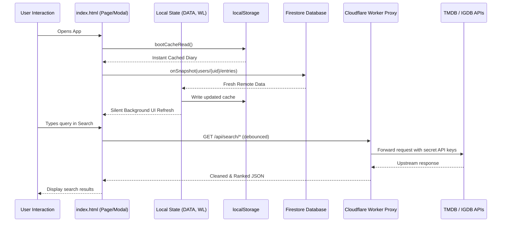

# 🗺️ Project Map — Codebase Topology & Code Index

> **Tag**: `#topology` `#code-map` `#architecture`
> **Related Notes**: [[HOME]], [[AI-START-HERE]], [[LOGGER-CONTEXT]], [[System Architecture]]

This document maps the real physical structure of the **Project-FlickShelft** repository, providing line-number anchors and functional sections for every part of the codebase.

---

## 1. Physical Directory Structure

```text
Project-FlickShelft/
│
├── index.html                  # Core application (all HTML, CSS, client JS)
├── server.js                   # Node.js local dev server & static file host (port 8080)
├── manifest.json               # PWA configuration manifest
├── icon-192.png                # App icon (192x192 px)
├── icon-512.png                # App icon (512x512 px)
├── logo.png                    # Logger logo graphic
├── Patchnotes.txt              # Historical changelog document
├── AGENTS.md                   # Agent technical instructions
├── README.md                   # Public GitHub overview
├── .gitignore                  # Git exclusion rules
│
├── worker/                     # Cloudflare Worker edge API proxy
│   ├── src/
│   │   └── index.js            # Worker logic (TMDB, IGDB, Image proxying, CORS)
│   ├── wrangler.jsonc          # Cloudflare Wrangler configuration
│   ├── package.json            # Worker dependencies (Wrangler devDependency)
│   ├── package-lock.json       # Lockfile for worker dependencies
│   ├── .dev.vars               # Local secret environment variables (gitignored)
│   ├── .dev.vars.example       # Template for required environment variables
│   ├── README.md               # Worker setup and deployment guide
│   ├── test-server.ps1         # PowerShell worker local tester
│   └── serve-app.ps1           # PowerShell port 5000 static app server
│
└── LOGGER-VAULT/               # This Obsidian Vault (Knowledge Base & Documentation)
```

---

## 2. Anatomy of `index.html` (~14,000 Lines)

The client application is organized into logical layers inside `index.html`:

| Section | Line Range (Approx.) | Primary Responsibilities | Detailed Note |
|---|---|---|---|
| **HTML `<head>`** | L1 – L38 | Metadata, PWA meta tags, Google Fonts, `html2canvas` library | [[Application Shell]] |
| **CSS `:root` & Reset** | L39 – L80 | Global design tokens, color palette, typography, glassmorphism variables | [[Styling and Design Tokens]] |
| **CSS: Navigation Dock** | L81 – L250 | Floating bottom capsule, indicator bar, active states, add button | [[Navigation System]] |
| **CSS: Header & Sticky** | L520 – L550 | Frosted glass headers, scroll blur transitions, safe area padding | [[Application Shell]] |
| **CSS: Month Headers** | L920 – L945 | Sticky month separators, faint entry count display, letter spacing | [[Diary Log Page]] |
| **CSS: Diary Rows** | L946 – L1100 | Letterboxd-style entry rows, status pills, rating badges, touch states | [[Diary Log Page]] |
| **CSS: Add/Edit Modal** | L1300 – L1700 | Floating squircle card, top-anchored layout, keyboard immunity | [[Add and Edit Entry Modal]] |
| **CSS: Watchlist** | L2100 – L2600 | Swipe action cards, drag-and-drop touch handles, countdown grid | [[Watchlist Page]] |
| **CSS: Calendar** | L2650 – L3050 | Month grid, date cells, multi-poster badges, responsive spacing | [[Calendar Page]] |
| **CSS: Profile & Stats** | L3100 – L3600 | Avatar, custom name editing, Top Picks grid, activity chart | [[Profile Page]] |
| **CSS: Deep Info Card** | L4500 – L5200 | Encyclopedia sheet, parallax backdrop hero, cast, certifications | [[Deep Media Info Card]] |
| **CSS: Movie Wall** | L5415 – L5860 | Pure poster grid, zero labels, responsive mobile/desktop media queries | [[Movie Wall Overlay]] |
| **HTML Markup** | L5860 – L6830 | All `<div class="page">` containers, modals, sheets, and SVG symbols | [[Application Shell]] |
| **JS: Firebase & Init** | L6840 – L7100 | Firebase SDK imports, Auth setup, Firestore listeners, Google Sign-in | [[Firebase Authentication]] |
| **JS: State & Cache** | L7100 – L7600 | `DATA`, `WL`, `lgr_cache_` multi-tier storage, deduplication logic | [[State Management]] |
| **JS: Diary Rendering** | L7600 – L8100 | `renderLog()`, month grouping, row generation, sort filtering | [[Diary Log Page]] |
| **JS: Watchlist Engine** | L8100 – L8600 | `renderWL()`, drag reorder handlers, swipe gesture recognizers | [[Watchlist Page]] |
| **JS: Calendar Engine** | L8600 – L9100 | `renderCalendar()`, date calculations, poster thumbnails | [[Calendar Page]] |
| **JS: Profile & Stats** | L9770 – L10400 | Profile rendering, animated stat count-up, activity bar graphs | [[Profile Page]] |
| **JS: Universal Search** | L11915 – L12400 | Debounced multi-provider search (TMDB + IGDB + Local Diary) | [[Universal Search Overlay]] |
| **JS: Deep Info Card** | L12400 – L13200 | `openDeepCard()`, live API fetching, cast extraction, providers | [[Deep Media Info Card]] |
| **JS: Movie Wall Engine**| L14300 – L14674 | Poster grid rendering, 1080px canvas snapshot generator, sharing | [[Movie Wall Overlay]] |

---

## 3. Anatomy of `worker/src/index.js` (~730 Lines)

The Cloudflare Worker routes and handlers:

| Route Path | Method | Description | Upstream Target | Note |
|---|---|---|---|---|
| `/api/health` | `GET` | Healthcheck and timestamp | None | [[Cloudflare Worker Proxy]] |
| `/api/search/movie` | `GET` | Search movies with query & year | `api.themoviedb.org/3/search/movie` | [[TMDB Integration]] |
| `/api/search/tv` | `GET` | Search TV series | `api.themoviedb.org/3/search/tv` | [[TMDB Integration]] |
| `/api/search/collection`| `GET` | Search movie collections/franchises | `api.themoviedb.org/3/search/collection`| [[TMDB Integration]] |
| `/api/search/game` | `GET` | Smart game search (acronyms, ranking) | `api.igdb.com/v4/games` via Twitch | [[IGDB Integration]] |
| `/api/movie/:id` | `GET` | Movie details + credits + release dates | `api.themoviedb.org/3/movie/:id` | [[TMDB Integration]] |
| `/api/movie/collection/:id`|`GET`| Full franchise movie timeline | `api.themoviedb.org/3/collection/:id` | [[TMDB Integration]] |
| `/api/tv/:id` | `GET` | TV details + credits + content ratings | `api.themoviedb.org/3/tv/:id` | [[TMDB Integration]] |
| `/api/game/:id` | `GET` | Game details (translated to RAWG shape) | `api.igdb.com/v4/games` via Twitch | [[IGDB Integration]] |
| `/api/image` | `GET` | Image proxy to bypass ISP DNS block | `image.tmdb.org/t/p/:size/:path` | [[Cloudflare Worker Proxy]] |

---

## 4. Local Development Server: `server.js` (~380 Lines)

- **Entry Point**: Node.js core `http`, `fs`, `path`, `url` modules (zero npm dependencies).
- **Static Hosting**: Serves `index.html`, icons, manifest, and assets on port `8080`.
- **API Proxying**: Automatically forwards `/api/*` requests to `UPSTREAM_PROXY` (`logger-proxy.ignoredatom.workers.dev`).
- **Direct TMDB Fallback**: Features direct TMDB querying using a local dev API key for offline/local development.
- **Mock Certifications**: Hardcoded `POPULAR_TV_RATINGS` and `POPULAR_MOVIE_RATINGS` for instant testing without network requests.
- **Local Network Support**: Displays LAN IP address (`http://192.168.*:8080`) for seamless mobile phone debugging on Wi-Fi.
- See [[Local Development Server]].

---

## 5. Relationships Between Layers


